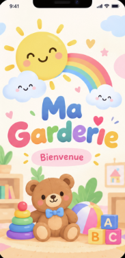
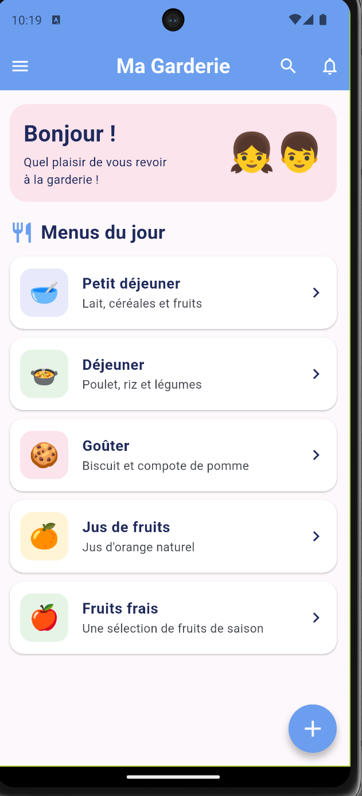
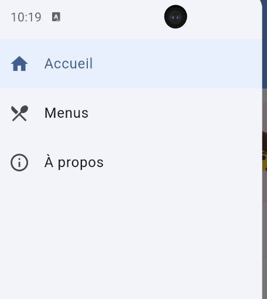
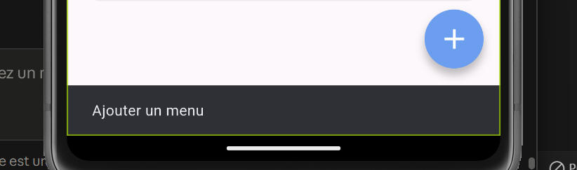

# Ma Garderie 🧸

Application mobile Flutter de gestion des menus d'une garderie d'enfants.
Les données sont déclarées localement dans le code (aucun backend, aucune base de données, aucune authentification).

## Technologies utilisées
- Flutter / Dart
- Git et GitHub

## Installation et exécution
```bash
git clone https://github.com/2m11ne/garderie-mobile-g2.git
cd garderie-mobile-g2
flutter pub get
flutter run
```

## Captures d'écran

| Splash Screen | Page principale |
|---|---|
|  |  |

| Drawer ouvert | Message après interaction |
|---|---|
|  |  |
